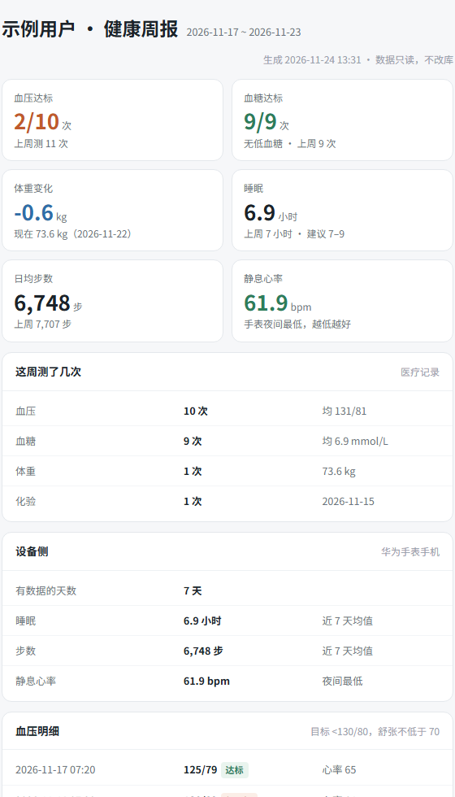

<div align="center">

<h1>health-db · 个人健康数据库技能</h1>

<p>把散落在手机截图、化验单、处方里的健康数据，收进一个属于你自己的 SQLite 文件，<br>再变成能给医生看的离线看板与周报。数据不出本机。</p>

<a href="https://github.com/kele551/health-db-skill/blob/main/LICENSE"></a>


<a href="https://github.com/kele551/health-db-skill/stargazers"></a>
<a href="https://github.com/kele551/health-db-skill/network/members"></a>

<a href="https://github.com/kele551/health-db-skill/issues"></a>

<p>🏠 主页：<a href="https://kele551.github.io/health-db-skill/">kele551.github.io/health-db-skill</a></p>

</div>

## 这是什么

一套「个人健康数据」工具 + 一个 Agent 技能（Claude Code / Codex / 豆包等支持 `SKILL.md` 的客户端都能用）：

- **一人一库**：一个 SQLite 文件（25 张标准表），姓名只写在 `meta`，换人换库，互不串。
- **四种录入**：一句话、手机截图、化验单、处方/检查单；认不准就停「待确认」，不猜不编。
- **规则提示**：按参考区间与个人目标标出越界项，只说「需留意」，**不做诊断**。
- **两个页面**：系统分组看板 + 一周周报，单文件 HTML（内嵌 CSS/SVG），断网可看，直接发给医生。
- **FHIR R4**：导出 Patient / Observation / Condition / MedicationStatement / DiagnosticReport / Encounter，接得上开源医疗项目。
- **全程离线**：脚本默认不联网；要不要备份、备份到哪，由你自己决定。

> 演示数据全部虚构。仓库里没有、也不会有任何真人的病历。

## 长这样

| 健康看板 | 健康周报 |
|---|---|
|  |  |

## 快速开始

```bash
git clone https://github.com/kele551/health-db-skill.git
cd health-db-skill

# ① 建自己的空库
python tools/健康库.py init data/医疗与运动健康数据库.db "你的名字"

# ② 写入指标字典（单位 / 参考区间 / LOINC）
python tools/指标字典导入.py

# ③ 出第一份看板
python tools/健康档案看板.py --out data/看板.html
```

想先看效果，不建库也行：

```bash
python demo/make_demo.py      # 生成虚构演示库 + 演示看板 + 演示周报
```

## 录入

| 你手上是什么 | 命令 |
|---|---|
| 一句话 / 语音转写 | `python tools/健康文字录入.py --text "今天早上八点血压128/82，心率76"` |
| 手机截图（血压 / 血糖 / 体重 / 步数 / 睡眠 / 心率） | `python tools/健康截图入库.py --file "<图片>" --no-cloud` |
| 化验单 / 检验单 | `python tools/化验单入库.py --file "<图片>"` |
| 处方 / 检查单 / 缴费单 | `python tools/单据识别.py --file "<图片>"` |
| 新的一类指标 | `python tools/健康指标扩展.py add --category 血氧 --value 96 --unit % --ref "95–100"` |

- `--dry-run` 只识别不写盘；`单据台账.py check "<日期/流水号/药名>"` 查重，避免同一张单入两遍。
- OCR 依赖 `onnxruntime`（`pip install onnxruntime`）；装在别的解释器里时用 `HEALTH_OCR_PY` 指过去。

## 页面与导出

```bash
python tools/健康档案看板.py --out data/看板.html     # 系统分组 + 区间标尺 + 三色提示
python tools/健康周报.py --out data/周报.html        # 一周达标率、变化、待办
python tools/导出FHIR.py --out data/fhir            # FHIR R4 六类资源
```

页面是纯本地文件：内嵌 CSS 与自写 SVG，没有外部 CDN、没有统计脚本。

## 作为 Agent 技能安装

`skill/` 就是技能目录（`SKILL.md` + 4 份 references）。把它放进客户端的技能目录即可：

```bash
# Claude Code
cp -r skill ~/.claude/skills/health-db

# 其它客户端：把 skill/ 放进它的 skills 目录，或直接让 Agent 读 SKILL.md 的绝对路径
```

装好后可以直接说：「把这张化验单记进健康库」「出这周的周报」「导一份 FHIR 给 Fasten Health」。

## 目录

```
tools/      采集与入库脚本（健康库.py 是唯一数据层）
overview/   schema.json、看板定义.json、总览模板.html、FHIR 映射
data/       指标字典.json；你自己的库与产物放这里
demo/       虚构演示库与生成脚本
skill/      技能正文 + references
docs/       使用说明、主页、截图
```

## 隐私与边界

- 数据只在你自己的磁盘上；脚本不埋点、不上传、不请求任何第三方接口。
- 所有判定都是规则计算（参考区间 / 个人目标），**不是医疗建议**；诊断与用药以主诊医生为准。
- 识别不出的字段留空，缺日期不用今天顶替，宁可「待确认」也不编。
- 想备份就复制 `.db`；仓库与代码里不写任何人的姓名、医院、病案号。

## 常见问题

**Q：能不能多人共用一个库？**
不建议。一人一个 `.db`，用 `HEALTH_DB` 或 `--db` 指向各自的库，天然隔离。

**Q：数据从哪来？**
自己测的（血压计/血糖仪/体重秤）、手表的（华为/小米等导出包）、医院的（化验单/处方/检查单）。截图识别后写库，原始图自己留存。

**Q：为什么不内置就诊摘要？**
摘要版式与病种强相关，天然个性化。这个仓库给的是数据层、看板与周报；摘要按 `references/看板规范.md` 的口径自建模板即可。

## 许可

MIT © 海风（kele551）
